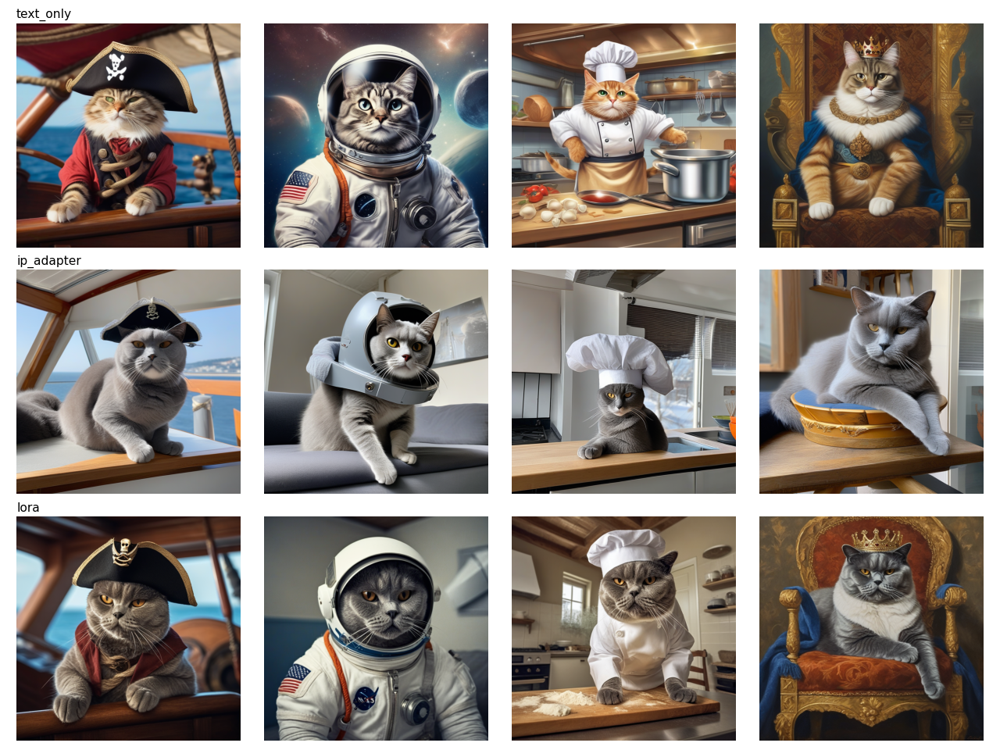

# Run 1: DreamBooth-LoRA vs. IP-Adapter vs. text-only (2026-10-22)

Notebook: `worker/week2_dreambooth.ipynb`. Pet: Boss (grey British Shorthair), 3 reference photos.

**Setup**
- Base model: SDXL base 1.0 with the fp16-fix VAE. Generation at 768px, 25 steps, seeds 1 and 2, 4 scenes.
- LoRA: DreamBooth-LoRA, rank 8, 500 steps, lr 1e-4, 768px, no prior preservation, token `sks`.
- IP-Adapter: `ip-adapter_sdxl`, scale 0.6, conditioned on reference photo 0.
- GPU: Colab T4.

## Results (mean ± std, n=8 per method)

| method | DINO | CLIP-I | CLIP-T | inference | per-pet training |
|---|---|---|---|---|---|
| text_only | 0.038 ± 0.041 | 0.620 | 0.317 ± 0.021 | 13.3 s | none |
| ip_adapter | 0.663 ± 0.080 | 0.727 | 0.271 ± 0.026 | 14.3 s | none |
| lora | 0.631 ± 0.106 | 0.665 | 0.317 ± 0.026 | 14.9 s | 21.1 min |

## Findings
- Both methods bring the pet in: DINO goes from 0.04 to about 0.65.
- IP-Adapter gives up prompt-following (CLIP-T 0.317 → 0.271). It copies the reference photo's indoor setting into every scene, and the "king" scene loses its throne and crown entirely.
- LoRA keeps text-only prompt-following (0.317) and puts the pet in the requested scene. Visually it is the clear winner.
- The LoRA adds about 0.6 s per image because the adapter is applied unfused at every step.

## Caveats and fixes for run 2
- **The DINO metric is fooled by background leakage.** Whole-image DINO rewards IP-Adapter for reproducing the reference room. Next run: crop the pet before scoring, or use references with varied backgrounds.
- **IP-Adapter was scored against its own conditioning photo.** Next run: hold out reference photos for scoring only.
- **Small sample.** With n=8 and only 3 reference photos, the identity gap is within noise.
- **One setting per method.** Next run: sweep LoRA steps (50 to 500) and IP-Adapter scale (0.3 to 0.6) to get tradeoff curves.
