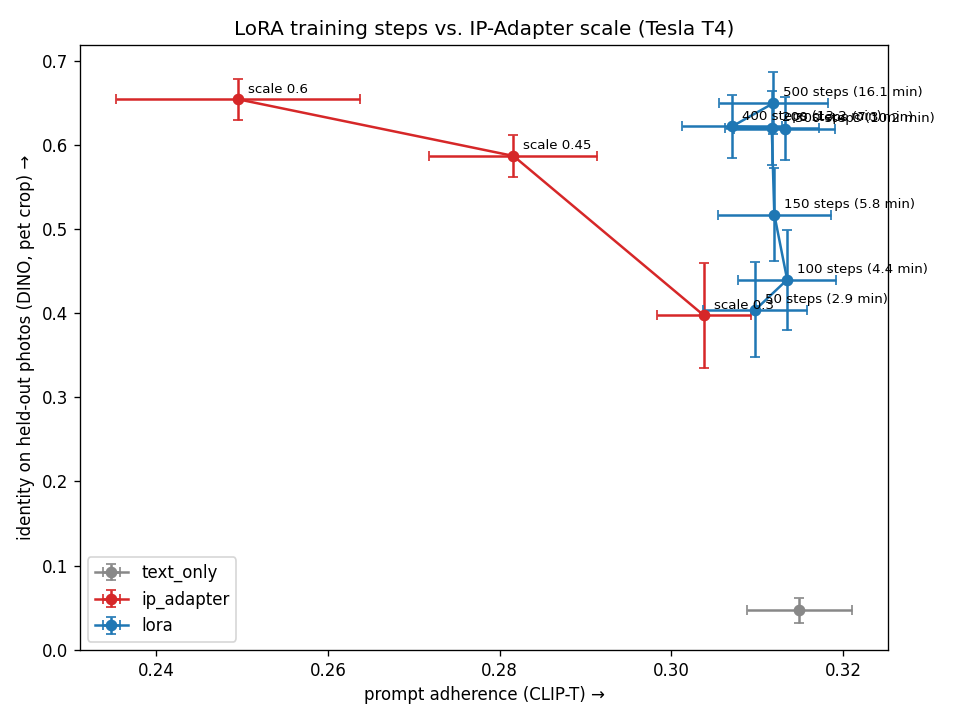

# Run 2: LoRA training-step sweep vs. IP-Adapter scale (2026-10-22)

Script: `worker/run2.py`, run as a private Kaggle kernel on a Tesla T4 (53 min end to end).

**Data:** Boss (grey British Shorthair), 8 photos. 6 are for training, and 2 are held out for scoring only (Boss4: indoors on the floor; Boss8: outdoors through a window). IP-Adapter is conditioned on a training photo (Boss2).

**Setup**
- LoRA: DreamBooth-LoRA, rank 8, lr 1e-4, 768px, token `sks`. One 500-step run, with a LoRA checkpoint saved every 50 steps.
- Generation: 768px, 25 steps, 4 scenes × 3 seeds, so 12 images per config.
- Identity: DINOv2 and CLIP-I against the held-out photos, scored on the full image and on an OWL-ViT crop around the cat. Prompt adherence: CLIP-T.

## Results (mean ± std, n=12)

| config | DINO (crop) | DINO (full) | CLIP-T | time to this LoRA* |
|---|---|---|---|---|
| text_only | 0.046 ± 0.050 | 0.073 | 0.315 ± 0.021 | n/a |
| IP-Adapter 0.3 | 0.397 ± 0.217 | 0.419 | 0.304 ± 0.019 | 0 |
| IP-Adapter 0.45 | 0.587 ± 0.085 | 0.589 | 0.282 ± 0.034 | 0 |
| IP-Adapter 0.6 | 0.655 ± 0.084 | 0.648 | 0.249 ± 0.049 | 0 |
| LoRA 50 steps | 0.404 ± 0.195 | 0.331 | 0.310 ± 0.021 | 2.9 min |
| LoRA 100 | 0.440 ± 0.206 | 0.393 | 0.314 ± 0.020 | 4.4 min |
| LoRA 150 | 0.517 ± 0.190 | 0.444 | 0.312 ± 0.023 | 5.8 min |
| **LoRA 200** | **0.621 ± 0.153** | 0.523 | **0.312 ± 0.019** | **7.3 min** |
| LoRA 300 | 0.620 ± 0.131 | 0.527 | 0.313 ± 0.020 | 10.3 min |
| LoRA 400 | 0.622 ± 0.130 | 0.578 | 0.307 ± 0.020 | 13.2 min |
| LoRA 500 | 0.650 ± 0.127 | 0.571 | 0.312 ± 0.022 | 16.1 min |

\* Wall time from launching training to the checkpoint, on a T4, including ~1.4 min of model loading. Training ran at ~1.75 s/step.

## Findings
1. **IP-Adapter is a tradeoff; LoRA is not.** Raising the IP-Adapter scale buys identity (0.40 → 0.66) at the cost of prompt adherence (0.30 → 0.25), and at 0.6 the costumes and scenes visibly break down (see grid). LoRA keeps text-only prompt adherence (~0.31) at every step count.
2. **LoRA identity plateaus at ~200 steps.** 200, 300 and 400 steps are equal (0.62), and 500 is within noise (0.65, standard error ~0.04). Below 150 steps the LoRA still draws generic orange or tabby cats in some scenes.
3. **200 steps cuts time-to-LoRA from 16.1 to 7.3 min on a T4 (2.2×) with no measurable identity loss.** On a faster GPU (L4 / 4090) this should be a few minutes; to be measured.
4. **LoRA at ≥200 steps matches IP-Adapter 0.6 on identity while keeping 25% more prompt adherence.**
5. **Background leakage, revisited:** against *held-out* photos, IP-Adapter's crop and full DINO are nearly equal (0.655 vs 0.648), so run 1's IP-Adapter lead came mostly from scoring against its own conditioning photo. LoRA scores *higher* on the crop than on the full image (0.65 vs 0.57), because its scenes don't resemble the reference photos. Whole-image DINO understates LoRA.
6. **Serving cost of a LoRA:** ~0.2 s to swap one in, and ~0.55 s extra inference per image unfused (15.1 vs 14.5 s on a T4). Fusing it into the weights is a week 3 item.

## Caveats
- One pet, two held-out photos, n=12 per config. The standard deviations are large, so read the curves, not single points.
- T4 timings only. Kaggle ignored the L4 request.
- `images/` (132 PNGs, 117 MB) and the LoRAs (`*.safetensors`) are kept locally and are not in git.
