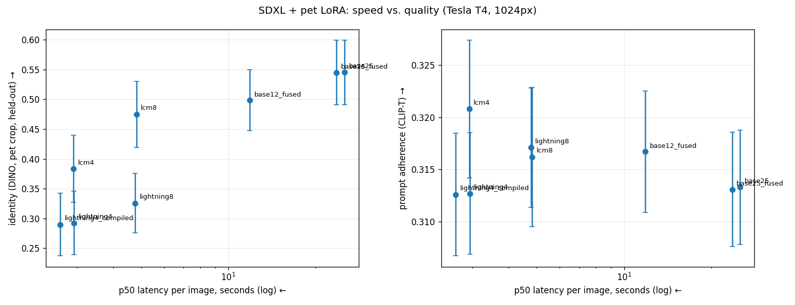

# Run 3: inference speed vs. quality with a pet LoRA (2026-10-22)

Script: `worker/run3.py`, run as a private Kaggle kernel on a Tesla T4 (23 min). Uses Boss's 250-step DreamBooth-LoRA from run 2 at scale 0.9. Generation at 1024px, 4 scenes × 3 seeds. Latency is measured warm, with one warm-up image per config excluded. Identity is DINO on a pet crop against held-out photos; prompt adherence is CLIP-T.

| config | p50 | speedup | DINO (crop) | CLIP-T | notes |
|---|---|---|---|---|---|
| base25 (Euler, CFG 6) | 25.2 s | 1.0× | 0.545 ± 0.19 | 0.313 | |
| base25_fused | 23.6 s | 1.07× | 0.545 | 0.313 | identical images |
| base12_fused | 11.8 s | 2.1× | 0.499 | 0.317 | |
| lcm8 (no CFG) | 4.8 s | 5.2× | **0.475** | 0.316 | best speed/identity |
| lcm4 | 2.9 s | 8.6× | 0.384 | 0.321 | |
| lightning8 (no CFG) | 4.8 s | 5.3× | 0.326 | 0.317 | |
| lightning4 | 2.9 s | 8.6× | 0.292 | 0.313 | |
| lightning4 + torch.compile | 2.6 s | 9.6× | 0.290 | 0.313 | 124 s to compile |

Peak VRAM: 9.6 GB (base) / 10.0 GB (two LoRAs).

## Findings
1. **Distillation LoRAs dilute the pet LoRA.** Lightning keeps images sharp but turns Boss into a generic beige/tabby cat (identity 0.55 → 0.29). LCM preserves much more (0.48 at 8 steps).
2. **LCM-8 is the best tradeoff:** 5.2× faster for −13% identity, with the same prompt adherence.
3. **Fusing the LoRA is free:** +7% speed with identical output.
4. **torch.compile:** +11% on top of 4-step Lightning, but 124 s of compile time. Worth it only on warm workers.
5. **Prompt adherence is unaffected** by any speedup (0.31–0.32).
6. **Resolution mismatch:** the LoRA was trained at 768px. At 1024px even base25 scores lower than run 2 at 768px (~0.62).

## Next (run 4)
- Rebalance adapter weights (pet 1.0–1.2, speed LoRA 0.7–0.8).
- Train the pet LoRA at 1024px.
- Try newer distillation LoRAs (Hyper-SD, DMD2).
- fp8 needs an L4/4090/H100 (RunPod).
