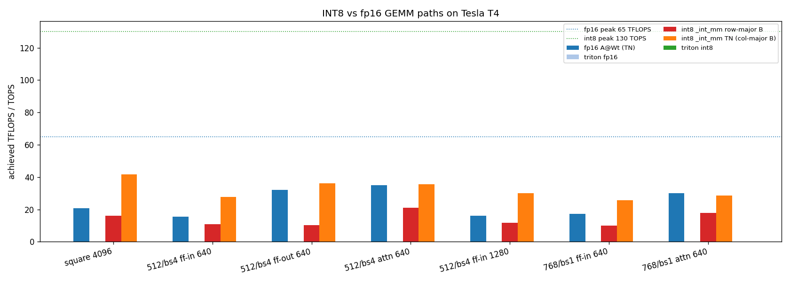

# Run 10: INT8 vs fp16 GEMM paths on a T4 (2026-10-23)

Script: `worker/run10.py`, a microbenchmark run as a private Kaggle kernel on a Tesla T4 (sm75), torch 2.11, triton 3.6. CUDA-event timing, 50 iterations after 5 warm-ups.

## Which kernel runs (M = K = N = 4096)

| path | cuBLAS / CUTLASS kernel | TOPS | vs fp16 TN |
|---|---|---|---|
| fp16 `A @ Wᵀ` (TN, what `nn.Linear` does) | `turing_fp16_s1688gemm_fp16_128x128_ldg8_f2f_tn` | 20.8 | 1.00× |
| fp16 `A @ B`, B row-major (NN) | `turing_fp16_s1688gemm_fp16_256x128_..._nn` | 21.5 | 1.04× |
| int8 `_int_mm`, B row-major (run 9) | `volta_igemm_int8_128x128_ldg4_nn` (no INT8 tensor cores) | 16.1 | 0.78× |
| **int8 `_int_mm`, B column-major (TN)** | **`cutlass_75_tensorop_i8816gemm_s8_128x128_tn_align16`** (Turing IMMA) | **41.8** | **2.01×** |

**Run 9's "INT8 is slower" was a layout artifact:** with B passed row-major, cuBLAS falls back to a Volta INT8 kernel without tensor cores. With the TN layout (the natural `nn.Linear` layout, `x @ Wᵀ`), CUTLASS's Turing IMMA kernel runs and delivers the expected ~2× over fp16.

## SDXL linear shapes (TOPS; speedup vs fp16 TN)

| shape (M, K, N) | fp16 TN | fp16 NN | int8 row-major B | **int8 TN** |
|---|---|---|---|---|
| 512/bs4 ff-in 640 (4096, 640, 5120) | 15.5 | 25.3 (1.63×) | 11.0 (0.71×) | **27.7 (1.78×)** |
| 512/bs4 ff-out 640 (4096, 2560, 640) | 32.0 | 43.9 (1.37×) | 10.2 (0.32×) | 36.1 (1.13×) |
| 512/bs4 attn 640 (4096, 640, 640) | 35.1 | 33.7 (0.96×) | 21.0 (0.60×) | 35.6 (1.01×) |
| 512/bs4 ff-in 1280 (1024, 1280, 10240) | 16.1 | 35.3 (2.19×) | 11.7 (0.72×) | **30.1 (1.87×)** |
| 768/bs1 ff-in 640 (2304, 640, 5120) | 17.2 | 32.4 (1.89×) | 10.1 (0.59×) | **25.8 (1.51×)** |
| 768/bs1 attn 640 (2304, 640, 640) | 30.1 | 23.7 (0.79×) | 17.7 (0.59×) | 28.7 (0.96×) |

## Findings
1. **INT8 tensor cores pay off on the large feed-forward GEMMs (1.5–1.9× vs fp16 TN)**; the square 640×640 attention projections gain nothing.
2. **Layout matters as much as precision on Turing.** For fp16 too, the NN layout (pre-transposed weights) is 1.4–2.2× faster than TN on the FF shapes. cuBLAS's TN kernel choice on the T4 is poor there, so re-laying out frozen weights could speed up fp16 without any quantization (to be verified end to end).
3. **Triton is not an option on sm75:** int8 `tl.dot` fails to compile (`PassManager::run failed`), and the fp16 Triton GEMM reaches 0.2 TFLOPS (no tensor cores). Custom INT8 work on the T4 has to go through cuBLASLt / CUTLASS (`torch._int_mm` with the TN layout works).
4. Achieved peaks are far below the data sheet (fp16 ≤ 44 of 65 TFLOPS, int8 ≤ 42 of 130 TOPS); the 70 W T4 is power-limited.
5. The kernel-name profiler only captured the first shape; later shapes returned empty lists (CUPTI quirk), so kernel identity is confirmed for the square problem only.

## Next
A frozen-base INT8 linear for training: INT8 TN GEMM (cuBLASLt) for the FF layers in forward and for the input gradient in backward, with per-token activation quantization fused by torch.compile (elementwise Triton kernels work on sm75); attention projections stay fp16. Compare end to end against fp16 TN and fp16 with pre-transposed (NN) frozen weights. Upper bound from these numbers: ~10–15% per training step (matmuls are 44% of a step).
