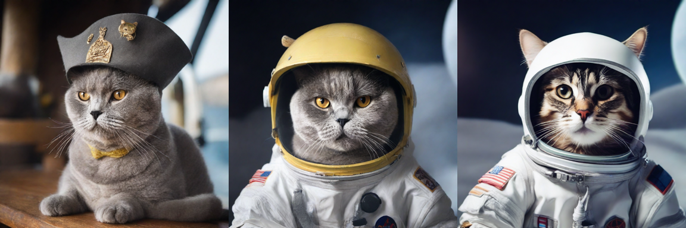

# Run 11: smoke test of the production worker code (2026-10-23)

Script: `worker/run11_smoke.py`, run as a private Kaggle kernel on a Tesla T4. It calls `train.train` and `handler.handler` exactly as RunPod would, on Boss's 6 training photos.

Result: both handlers work end to end.

| step | result |
|---|---|
| `train.py` import (SDXL components + Qwen2-VL on CPU) | 103 s cold (73 s of it model loading) |
| training (512px, **batch 2** on the T4, lr 4e-4, 200 images = 100 steps) | 323 s, LoRA 23.4 MB (fp16) |
| description (Qwen2-VL-2B, sdpa) | 7 s: `British Shorthair, gray, short, yellow` |
| `handler.py` import (SDXL + fused LCM + 32 LoRA slots) | 12.8 s |
| generation, 1024px, LCM-8 | 4.86 s first request with the LoRA (83 ms slot load), 4.89 s second (resident slot, 0 ms), 5.0 s without LoRA |

## Bugs found and fixed before building the image
1. **Training OOM at 512px batch 4 on the T4:** the text encoders and fp32 VAE stayed on the GPU during training. `train.py` now parks them on the CPU after caching (+~2 GB headroom). Batch 4 still peaks at ~14–15 GB, past a T4 but well within the L4's 24 GB, so the smoke test used batch 2.
2. **Description OOM:** Qwen2-VL's default eager vision attention materialized a 3.7 GiB attention matrix next to the training UNet. `describe.py` now uses sdpa and 128–256 × 28² pixels per photo.
3. **bf16 on a T4:** `torch.cuda.is_bf16_supported()` is True on a T4 through emulation, which made training ~5× slower (3.2 s/step). `train_fast.py` now uses native bf16 only on compute capability ≥ 8 (the L4 is 8.9), otherwise fp16 + loss scaling. Fixed after this run.
