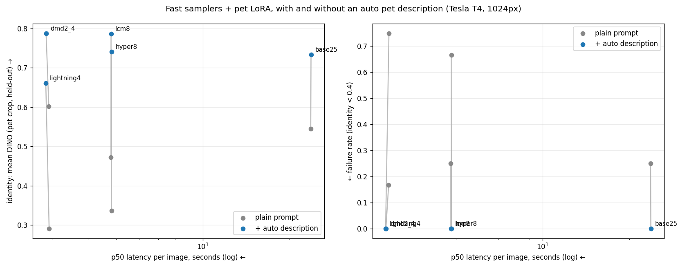

# Run 4: auto pet description + modern distillation LoRAs (2026-10-23)

Script: `worker/run4.py`, run as a private Kaggle kernel on a Tesla T4 (22 min). Uses Boss's 250-step LoRA (fused, scale 0.9). Generation at 1024px, 4 scenes × 3 seeds. Identity is DINO on a pet crop against held-out photos; "fail" means identity < 0.4. CLIP-T is scored against the plain scene prompt.

**Auto description** (Qwen2-VL-2B-Instruct, 4 training photos, fp16 on a T4): `British Shorthair, gray, short, yellow`. The model took 34 s to load and 12 s to generate.

| config | p50 | speedup | DINO mean | DINO worst | fail rate | CLIP-T |
|---|---|---|---|---|---|---|
| base25 | 23.7 s | 1.0× | 0.545 | 0.20 | 25% | 0.313 |
| base25 + desc | 23.7 s | 1.0× | 0.734 | 0.51 | 0% | 0.304 |
| lcm8 | 4.8 s | 4.9× | 0.472 | 0.16 | 25% | 0.317 |
| lcm8 + desc | 4.8 s | 4.9× | 0.787 | **0.75** | 0% | 0.302 |
| lightning4 | 2.9 s | 8.1× | 0.291 | 0.08 | 75% | 0.313 |
| lightning4 + desc | 2.9 s | 8.3× | 0.661 | 0.54 | 0% | 0.304 |
| hyper8 | 4.8 s | 4.9× | 0.337 | 0.07 | 67% | 0.313 |
| hyper8 + desc | 4.8 s | 4.9× | 0.741 | 0.67 | 0% | 0.301 |
| dmd2_4 | 2.9 s | 8.1× | 0.602 | 0.29 | 17% | 0.314 |
| **dmd2_4 + desc** | **2.9 s** | **8.3×** | **0.788** | 0.71 | **0%** | 0.305 |

## Findings
1. **The auto description removes every identity failure** (fail rate 0% for all methods, from up to 75%). The hard scenes (king, pirate) are fixed: LCM-8 pirate goes from 0.32 to 0.80.
2. **DMD2-4 + description: 8.3× faster than base25 and higher identity** (0.79 vs 0.55). Its worst image beats the old mean.
3. **Without a description, DMD2 is the only distillation LoRA that preserves the pet reasonably** (0.60, 17% fail); Lightning and Hyper-SD override it.
4. **Attribute leakage:** the unbound word "yellow" (meant for the eyes) colors the scene: yellow spacesuits, scarves, lemons. That also explains the small CLIP-T drop (0.313 → 0.304).

## Caveats
- **Missing control:** a no-LoRA + description row. DINO may reward any grey British Shorthair, so the LoRA's share of the gain is unmeasured.
- DMD2 is CC-BY-NC (research only). LCM-8 + description is the license-safe choice.
- One pet, n=12 per config, T4 timings only.

## Next (run 5)
- Ablation: no LoRA + description; and LoRA + description vs. description alone, against an identity metric that separates individuals of the same breed.
- Attribute-bound description prompt ("yellow eyes, short gray fur") to stop color leakage.
