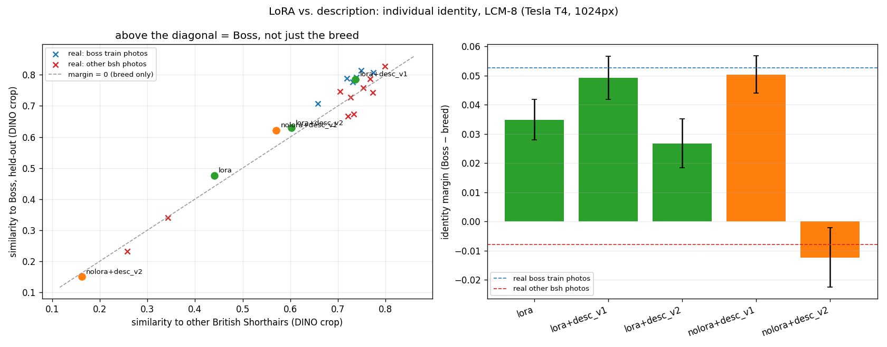

# Run 5: is it Boss, or just a grey British Shorthair? (2026-10-23)

Script: `worker/run5.py`, run as a private Kaggle kernel on a Tesla T4 (10 min). Production sampler only: LCM-8, fused LoRAs, 1024px, 4 scenes × 3 seeds.

**Question:** run 4's description ("British Shorthair, gray, short, yellow") removed all identity failures. Does the pet LoRA still add anything, or does the description just produce the breed?

**Metric:** identity *margin* = DINO (pet crop) similarity to Boss's held-out photos − similarity to 20 real British Shorthairs (Oxford-IIIT Pet). A margin of about 0 means "a British Shorthair, but not Boss".

## 1. Validating the metric on real photos

| set | sim to Boss | sim to breed | margin |
|---|---|---|---|
| Boss's training photos (6) | 0.781 | 0.728 | **+0.053 ± 0.013** (all positive) |
| other real British Shorthairs (10) | 0.650 | 0.658 | **−0.008 ± 0.034** (−0.06 to +0.04) |

The margin separates Boss from his breed **on average but weakly**: the effect is ~0.06, and single images overlap. It is usable for groups of 12, not for single images.

## 2. Generated images (LCM-8, n=12 each)

| config | sim to Boss | margin | fail rate | CLIP-T |
|---|---|---|---|---|
| LoRA, no description | 0.475 | +0.035 ± 0.024 | 33% | 0.317 |
| **LoRA + desc v1** | **0.786** | **+0.049 ± 0.026** | 0% | 0.302 |
| **no LoRA + desc v1** | 0.621 | **+0.050 ± 0.022** | 0% | 0.310 |
| LoRA + desc v2 | 0.629 | +0.027 ± 0.029 | 8% | 0.309 |
| no LoRA + desc v2 | 0.150 | −0.012 ± 0.035 | 83% | 0.313 |

desc v2 (VLM, attribute-bound prompt): `gray fur, yellow eyes, black nose, short tail, round ears, fluffy paws`. The model dropped the breed despite the instruction.

## Findings
1. **With DINO, the LoRA adds nothing beyond the description:** LoRA + desc and desc-only have the same margin (+0.049 vs +0.050), both at the level of Boss's real photos. The LoRA raises similarity to Boss *and* to the breed together.
2. **The breed word carries the identity.** Without "British Shorthair" (desc v2), the no-LoRA images become tabbies (83% fail).
3. **DINO measures identity at breed level.** A 12 s auto description matches 9 min of per-pet training on this metric. That is a statement about the metric as much as about the methods.

## Open questions / next
- An individual-level identity metric: an animal re-ID embedding, validated with the same real-photo margin test.
- Blind human A/B (LoRA + desc vs. desc only) as ground truth.
- Product: description-only needs no training (time to first image ~15 s instead of ~9 min). Keep the LoRA as an optional upgrade until a better metric shows it helps.
- VLM prompt: require the breed explicitly (v2 lost it).
