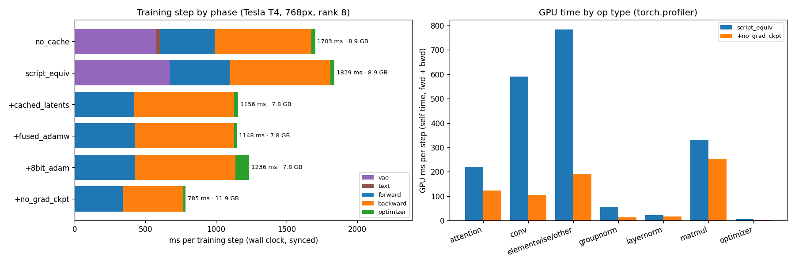
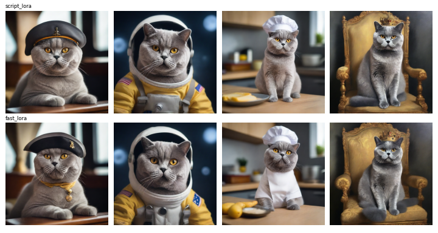

# Run 6: profiling and speeding up DreamBooth-LoRA training (2026-10-23)

Script: `worker/run6.py` with our own training loop `worker/train_fast.py`, run as a private Kaggle kernel on a Tesla T4 (15 min). 768px, rank 8, batch 1, 6 photos, fp16 autocast + loss scaling in every config. Times are the mean of 20 synced steps after 5 warm-up steps.

## Benchmark (ms per step)

| config | VAE | fwd | bwd | optimizer | **total** | peak mem |
|---|---|---|---|---|---|---|
| no_cache (prompt re-encoded too) | 578 | 390 | 684 | 28 | 1703 | 8.9 GB |
| **script_equiv** (= diffusers script) | 670 | 426 | 713 | 30 | **1839** | 8.9 GB |
| + cached latents | 0 | 422 | 705 | 29 | 1156 | 7.8 GB |
| + fused AdamW | 0 | 424 | 705 | 19 | 1148 | 7.8 GB |
| + 8-bit Adam (instead of fused) | 0 | 426 | 710 | 100 | 1236 | 7.8 GB |
| **+ no grad checkpointing** (fused AdamW) | 0 | 338 | 425 | 21 | **785** | 11.9 GB |

## Findings
1. **Cached VAE latents: −37%.** The script runs the stock VAE encoder in fp32 every step; fp32 cuDNN convolutions (`scudnn_winograd`, no tensor cores) take ~550 ms/step to re-encode the same 6 photos. Latents are cached as the latent distribution (mean, std) and sampled per step, so training stays equivalent (no augmentation in the default config).
2. **Cached text embeddings: no gain over the script**, which already encodes the fixed prompt once. The no_cache vs script_equiv difference is run-to-run noise in the VAE time.
3. **fp16 + loss scaling** is a correctness requirement on the T4 (no bf16), not a speedup; the script already uses it.
4. **8-bit Adam is slower (100 vs 19 ms) and saves no memory.** A rank-8 LoRA has ~6M trainable params, so the optimizer state is tiny and quantization overhead dominates. Fused AdamW is the right choice.
5. **No gradient checkpointing: another −32%** for +4.1 GB (11.9 GB still fits a T4).
6. **Total: 1839 → 785 ms/step (2.34×).**

## Where the time goes now (torch.profiler, fastest config, GPU self time per step)
matmul (mm/addmm in attention + FF + LoRA) ~254 ms · attention ~123 ms (mostly `efficient_attention_backward`; FlashAttention needs sm80+) · conv ~104 ms · dtype casts (`copy_`, fp32 LoRA ↔ fp16 UNet) ~66 ms · GroupNorm + LayerNorm ~29 ms · optimizer ~3 ms.

Profiler caveats: (a) this run's category split double-counted cuDNN kernel rows under "elementwise/other" (fixed in `train_fast.py` for later runs); (b) autograd runs backward on its own thread, so the profiler's "backward" range is empty. The phase split above uses synced wall-clock timing instead. Chrome traces are kept locally in `traces/` (not in git).

## Time to LoRA (250 steps)
| | diffusers script (run 2) | train_fast (run 6) |
|---|---|---|
| model loading | 86 s | 48 s |
| 250 steps | 440 s | **193 s** (0.77 s/step) |
| **total** | **~8.8 min** | **~4.0 min** |

## Quality is unchanged
Production generation (LCM-8 + description, same seeds) from both LoRAs: identity (DINO crop, held-out) 0.781 (fast) vs 0.786 (script), worst image 0.721 vs 0.736; the images are visually near-identical (see grid).

## Next levers
Remove the fp32↔fp16 casts (fp16 LoRA weights or a fused cast), `channels_last` for convs, `torch.compile` on the training step, more photos per step (batching), and a fused LoRA matmul in Triton (overlaps with multi-LoRA serving).
