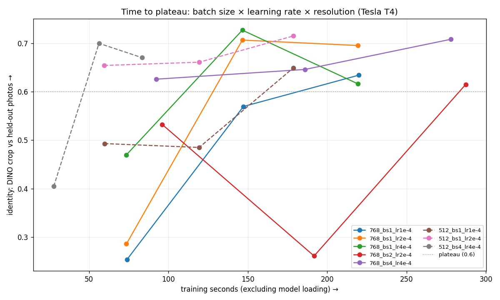
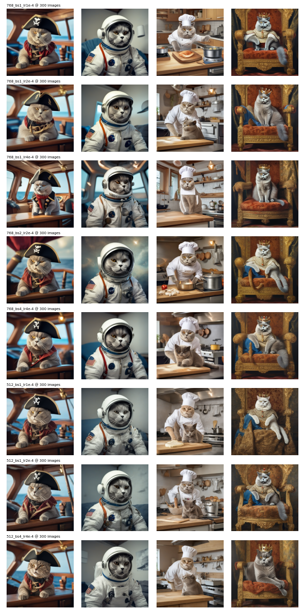

# Run 7: cast fix, torch.compile, and time to plateau (2026-10-23)

Script: `worker/run7.py` with `worker/train_fast.py`, run as a private Kaggle kernel on a Tesla T4 (66 min).

## Part 1: step speed (768px, batch 1, cached latents/text, fused AdamW, no grad checkpointing)

| config | ms/step | peak mem | first step |
|---|---|---|---|
| run 6 fastest | 698 | 11.9 GB | 1.4 s |
| + cast fix (fp16 LoRA weights, fp32 masters) | 711 | 11.7 GB | 0.7 s |
| + cast fix + torch.compile | 682 | 10.1 GB | 299 s |

- **Cast fix: no gain.** The per-use LoRA casts are gone, but `aten::copy_` is still ~49 ms/step, mostly the two foreach copies over 1,120 LoRA tensors plus other autocast casts. The cost moved rather than disappeared.
- **torch.compile: −2% step time and −1.6 GB**, for ~5 min of compilation on Kaggle's 2-core CPU. Not worth it for one-off per-pet training without a warm worker or a compile cache.
- Absolute times differ from run 6 (698 vs 785 ms for the same config): Kaggle assigns different T4 hosts. Compare within a run.

Profile (compiled, GPU self time per step): matmul ~300 ms (mm 208 + addmm 93), attention ~135 ms (backward 105), conv ~120 ms, Triton fused elementwise ~56 ms, norms ~59 ms, optimizer ~4 ms.

## Part 2: time to plateau

Each config trains to 300 images seen and saves a LoRA at 100/200/300. Every snapshot generates the same 4 images (Euler 25 steps, 768px, no description, seed 1), scored with DINO (pet crop) against held-out photos. Plateau = identity ≥ 0.60 (run 2 plateaued at ~0.62).

| config (res, batch, LR) | s / 100 images | grad ckpt | peak | identity @100 / 200 / 300 | **s to plateau** |
|---|---|---|---|---|---|
| 768, 1, 1e-4 | 73 | no | 11.7 GB | 0.25 / 0.57 / 0.63 | 220 |
| 768, 1, 2e-4 | 73 | no | 11.7 GB | 0.29 / 0.71 / 0.70 | **147** |
| 768, 1, 4e-4 | 73 | no | 11.7 GB | 0.47 / 0.73 / 0.62 | 147 |
| 768, 2, 2e-4 | 96 | yes | 14.9 GB | 0.53 / 0.26 / 0.62 | 287 |
| 768, 4, 4e-4 | 92 | yes | 14.9 GB | 0.63 / 0.65 / 0.71 | 93 |
| 512, 1, 1e-4 | 60 | no | 9.4 GB | 0.49 / 0.49 / 0.65 | 179 |
| 512, 1, 2e-4 | 60 | no | 9.4 GB | 0.65 / 0.66 / 0.72 | **60** |
| **512, 4, 4e-4** | **28** | no | 15.0 GB | 0.40 / 0.70 / 0.67 | **56** |

## Findings
1. **Batching only pays off when it fits without gradient checkpointing.** At 768px, batch ≥ 2 needs checkpointing and is slower per image (92–96 vs 73 s/100). At 512px, batch 4 fits (15.0 GB) and is 2.1× faster per image than batch 1 at 512 and 2.6× faster than 768/bs1: at batch 1, the T4 isn't saturated at 512px.
2. **A higher LR halves the images needed** (plateau at 200 instead of 300). 4e-4 already falls again at 300 images.
3. **Time to plateau: 220 s → 56 s** (512, bs4, lr 4e-4). With 48 s of model loading, a usable LoRA in ~1.7 min on a T4 (diffusers script: ~8.8 min).

## Caveats
- **Noisy curves:** each snapshot is 4 images (1 seed), so single points jump (768/bs2 @200 = 0.26). Trust the trends, not single values.
- **Double-cat artifact:** several configs (more often 512 and bs4) put a second, human-like chef cat next to Boss in the chef scene. DINO doesn't penalize it, so the faster configs need a visual check (see grid).
- 512px LoRAs are evaluated at 768px; quality at 1024px is untested.

## Implications for the next optimizations
- A custom attention-backward kernel can save at most ~15% of a step (~7–8% if 2× faster): smaller than the LR (−33%) or 512 + batching (−75%) levers.
- Matmuls are 44% of the step, but Turing's INT8 tensor cores need int8 activations as well (W8A8) to be faster; weight-only INT8 mainly saves memory.
