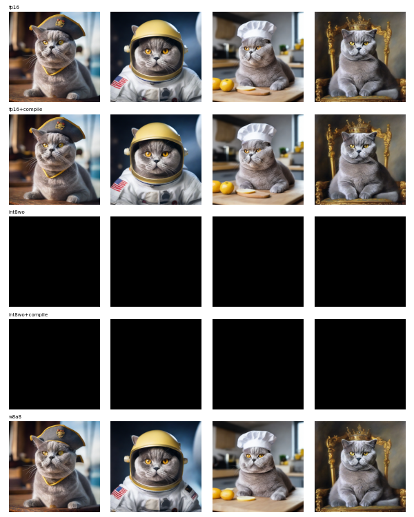
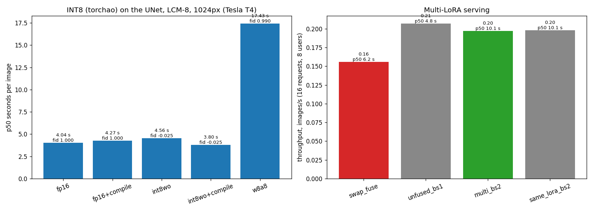

# Run 8: INT8 and multi-LoRA serving (2026-10-23)

Script: `worker/run8.py` + `worker/multi_lora.py`, run as a private Kaggle kernel on a Tesla T4 (44 min). Production generation: SDXL + LCM-LoRA (8 steps, guidance 1) + Boss's 250-step LoRA (0.9) + auto description, 1024px.

## A. INT8 on the UNet (torchao 0.10 on torch 2.11)

| config | p50 | first call | peak mem | identity | fidelity to fp16 |
|---|---|---|---|---|---|
| fp16 | **4.04 s** | 4.8 s | 9.6 GB | 0.786 | 1.000 |
| fp16 + compile | 4.27 s | 120 s | 9.6 GB | 0.786 | 1.000 |
| int8 weight-only | 4.56 s | 4.5 s | 7.4 GB | ✗ black images (NaN) | ✗ |
| int8 weight-only + compile | 3.80 s | 1060 s | 7.4 GB | ✗ black images (NaN) | ✗ |
| W8A8 (int8 act + weights) | 17.4 s | 17 s | 7.4 GB | 0.787 | 0.990 |
| W8A8 + compile | ✗ crashed: `_int_mm` needs > 16 rows (time-embedding linears have 1) | | | | |

- **Weight-only INT8 produced NaN (black) images.** pip installed torchao 0.10, which predates torch 2.11 (the log shows a dependency conflict). Most likely a version mismatch, not an INT8 property. Not a valid measurement.
- **W8A8 is correct but 4.3× slower eagerly:** activations are quantized on the fly in separate kernels. Compiling would fuse them, but it fails on the tiny time-embedding layers.
- **Fix for a later attempt:** a torchao build matching torch, plus quantizing only the transformer-block linears (`filter_fn`). Better done on an L4/4090 together with fp8.
- torch.compile gave no inference speedup on the T4 here (4.27 vs 4.04 s).

## B. Multi-LoRA serving (16 requests, 8 users: Boss + 7 synthetic LoRAs with Boss's shapes and per-tensor scale)

| strategy | images/s | p50 request | notes |
|---|---|---|---|
| swap_fuse (load + fuse per request, unfuse after) | 0.156 | 6.2 s | 1.7 s of each request is the swap |
| **unfused_bs1** (all LoRAs resident, `multi_lora.py`) | **0.207** | **4.8 s** | +33% throughput; +26 MB per user |
| multi_bs2 (2 different LoRAs per forward) | 0.197 | 10.1 s | |
| same_lora_bs2 (upper bound) | 0.198 | 10.1 s | |
| multi_bs4 / same_lora_bs4 | OOM | | 1024px batch 4 doesn't fit in 15 GB |

- **Resident LoRAs beat swapping:** +33% throughput, −23% p50 latency, at ~26 MB of GPU memory per user.
- **Per-sample LoRA gather is ~free:** multi-LoRA batch 2 matches the same-LoRA upper bound.
- **Batching doesn't help on a T4 at 1024px:** batch 1 already saturates the GPU, so batch 2 doubles latency at equal throughput. Re-test on A100/H100-class GPUs.
- **Correctness:** Boss through the batched multi-LoRA path vs. the fused path, same seed: DINO similarity 0.9998 (bs1), 0.999 (bs2); mean abs pixel diff 1.3–2.4 / 255 (fp16 rounding of fusion).
- **Scheduling rule:** fusing saves ~0.7 s per image (4.04 vs 4.77 s) but a swap costs ~1.7 s, so fusing pays off only from ~3 consecutive images of the same user. A scheduler can group requests by user and fuse only for long runs.
