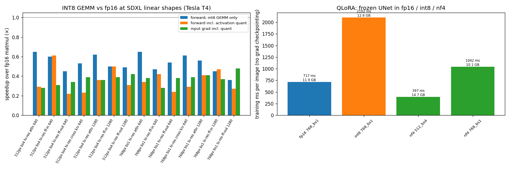
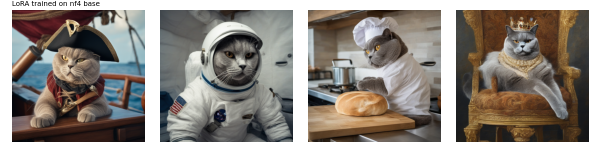

# Run 9: quantization for training on a T4 (2026-10-23)

Script: `worker/run9.py`, run as a private Kaggle kernel on a Tesla T4 (8 min).

## B. INT8 GEMM feasibility (go/no-go for INT8 training)

`torch._int_mm` vs fp16 matmul at SDXL's transformer-block linear shapes (attention, FF in/out, cross k/v), at 512px/bs4 and 768px/bs1 token counts. Speedups over fp16 across all 14 shapes:

| | speedup |
|---|---|
| INT8 GEMM only | **0.36–0.65×** (slower) |
| forward incl. per-token activation quantization | 0.22–0.61× |
| input gradient (g·W) incl. quantization | 0.28–0.48× |

**Even the raw INT8 GEMM is 1.5–2.8× slower than fp16 on Turing.** The T4's INT8 tensor cores need Turing-specific (IMMA) data layouts that PyTorch's generic `_int_mm` path doesn't use on sm75. **INT8 training on a T4 is a no-go with current PyTorch tooling**; it would need hand-written CUTLASS IMMA kernels. Revisit on Ampere+ (A100 / L4 / 4090), where `_int_mm` and fp8 are fast.

## A. QLoRA: frozen UNet in fp16 / int8 (bitsandbytes LLM.int8) / nf4, LoRA in fp32, no grad checkpointing

| base | 768px bs1 | 512px bs4 (production) | 768px bs2 |
|---|---|---|---|
| fp16 | 717 ms/img, 11.9 GB | OOM* | OOM |
| int8 | 2102 ms/img, 12.6 GB | OOM | OOM |
| nf4 | 1042 ms/img, 10.1 GB | 397 ms/img, 14.7 GB | OOM |

\* Fit at 15.0 GB in run 7. Here memory left over from the preceding configs tipped it over. The same fragmentation made the full fp16 and int8 training runs OOM; only nf4 trained.

- **Memory: small win.** At 768px, activations, not weights, dominate. nf4 saves 1.8 GB of peak (5.1 → ~1.4 GB of weights), and 768/bs2 still doesn't fit.
- **Speed: loss.** nf4 is +43–45% slower per image (dequantization on every use). bitsandbytes int8 is 2.9× slower and uses *more* memory.
- **Quality transfers:** the LoRA trained on the nf4 base (production config, 200 images, 77 s) used on the normal fp16 base reaches identity 0.638 (plateau level), CLIP-T 0.314, and looks like Boss in all scenes (1 seed).

## Conclusion
On a T4 with SDXL, quantizing the frozen base buys little memory and costs speed; QLoRA becomes useful only for models that don't fit at all (Flux, video). The speedups that worked on this GPU are the ones from runs 6–7: cached latents, no gradient checkpointing, a higher LR, and 512px with batch 4.
