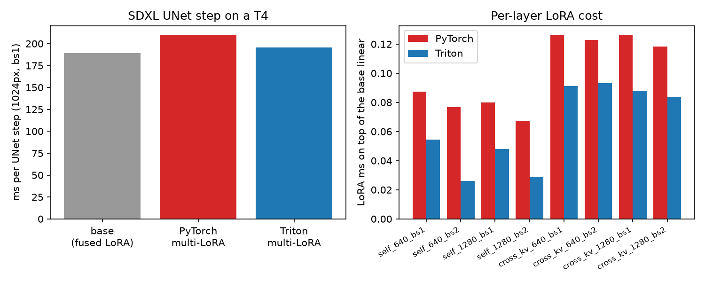

# Runs 12–13: is multi-LoRA a bottleneck, and does a fused Triton kernel fix it? (2026-11-03/06)

Scripts: `research/runs/run12_lora_profile.py`, `research/runs/run13_lora_kernel.py`, kernel in `worker/lora_kernels.py`. Tesla T4 (private Kaggle kernels) and NVIDIA L4 (RunPod secure pod, ~$0.015 incl. two failed starts), SDXL UNet at 1024px, random rank-8 LoRAs. Run 12's results: `../2026-11-03_run12_lora_profile/results.json`.

## The kernel

Punica/S-LoRA-style shrink + expand, segmented by image (SGMV: each image is one segment sharing one pet's LoRA):
- shrink: `h = scale[s] · x @ A[s]ᵀ`, the slot looked up in the kernel (no gather kernels), split along K so 77- and 1024-token layers still fill the 40 SMs, writing fp32 partials
- expand: sums the partials and does `y += h @ B[s]ᵀ` in place (no delta tensor, no separate scale/add)
- images on slot 0 (no LoRA) exit immediately

## Headline (L4)

| UNet step, 1024px | bs1 | bs2 (two pets) | bs4 (two pets) |
|---|---|---|---|
| base (LoRA fused into weights) | 189.4 ms | 374.1 ms | 719.4 ms |
| wrapper, no LoRA | 189.7 ms | 374.2 ms | 722.4 ms |
| PyTorch multi-LoRA | 210.1 ms | 407.9 ms | 805.5 ms |
| **Triton multi-LoRA** | **195.5 ms** | **386.8 ms** | **740.8 ms** |
| LoRA overhead removed | 70% | 62% | 75% |
| step speedup vs PyTorch | **1.074×** | 1.055× | **1.087×** |

- Multi-LoRA serving now costs 3% over a single fused LoRA (6 ms/step at bs1) instead of 11%, with all pets resident and different pets in one batch.
- Correct: worst error vs. fp32 within 1.1e-5 of the PyTorch fp16 path; UNet output cosine 1.0000 at bs1/2/4.
- Best tiles on the L4: shrink block_t 32, block_k 64, split-K to ~320 programs; expand 64×64. Now the defaults.
- The L4 also hits its 72 W cap (2040 → 1095 MHz), so the round-robin timing mattered here too.
- On by default on Ampere+ (`multi_lora.py`), off on the T4.

## T4 results

**Correct:** error vs. an fp32 reference is no worse than the PyTorch fp16 path for all shapes, batch 1 and mixed batch 2. UNet output vs. the PyTorch path: cosine 1.0000, max abs 0.004.

**Thermal throttling made the earlier measurements wrong.** The T4 starts at full clock and drops to ~945 MHz at 76 °C / 70 W. Timing configs one after another (runs 8, 12, and run 13 v1) made later configs look slower. Measured round-robin (one step of each config per round):

| UNet step, 1024px | bs1 | bs2 (two pets) |
|---|---|---|
| base | 438 ms | 971 ms |
| wrapper, no LoRA | 437 ms | 970 ms |
| PyTorch multi-LoRA | 468 ms | 1058 ms |
| Triton multi-LoRA | 474 ms | 1055 ms |

- The real LoRA overhead is **30 ms/step (6.9%, ~0.24 s/image)**, not the 86 ms (17.6%) from run 12. The 34–52 ms "wrapper overhead" was entirely throttling.
- The fused kernel is at **parity** (−1.2% at bs1, +0.3% at bs2): within noise, so it stays off by default (`MULTI_LORA_TRITON=1` to enable).
- v1 (no split-K, block_t 128) was 9% slower: 1–8 programs for 40 SMs on the short layers.

## Why no win on the T4

- The remaining 30 ms is spread over 560 layers (~50 µs each). PyTorch's cuBLAS bmm uses tensor cores on sm75; Triton has no tensor-core path on the T4 (run 10), so the kernel's matmul part is slower and eats the memory savings.
- The per-layer microbenchmarks in `results.json` were also timed sequentially, so they carry the same throttling bias. Only the round-robin UNet numbers are reliable.

## Next

- Any T4 benchmark must interleave configs or lock clocks. Run 8's multi-LoRA numbers should be re-checked the same way.
